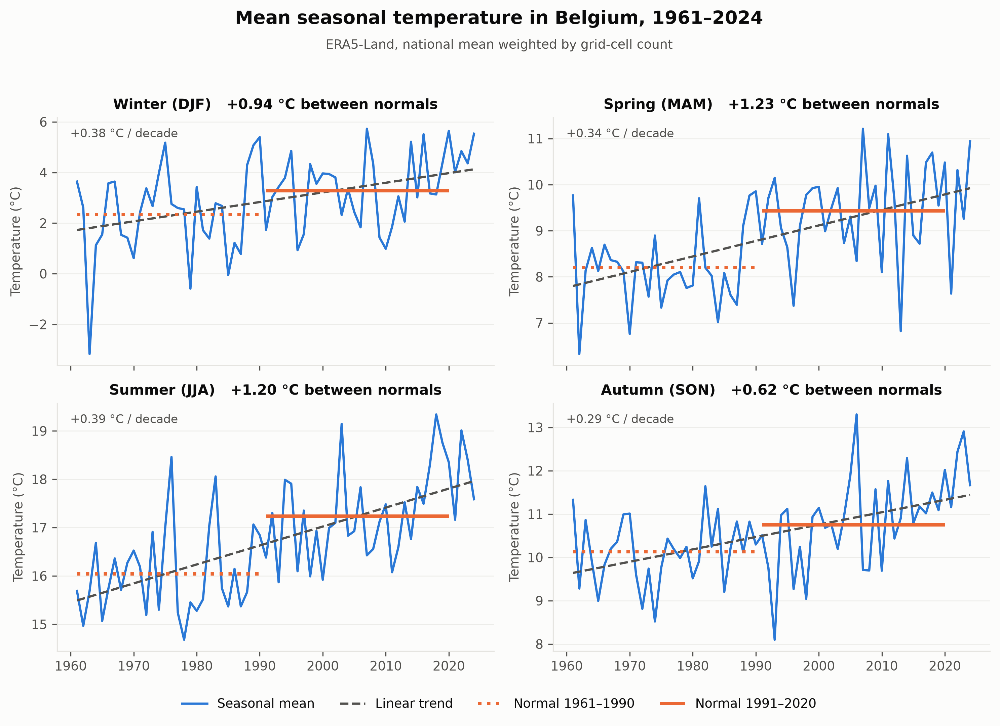
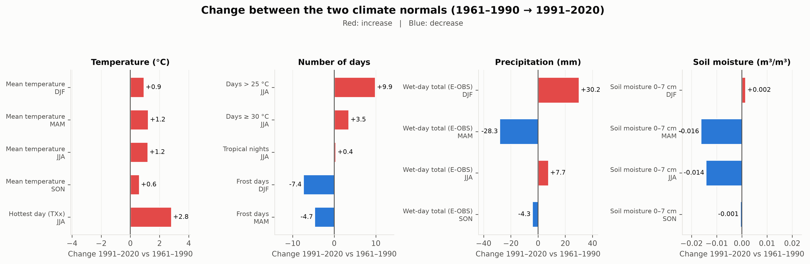

# Belgium's Changing Seasons — seasonal climate change in Belgium (1961–2024)

How has Belgium's seasonal climate shifted since the 1960s, and how is vegetation responding today?
This repository holds the full processing chain behind the project: open datasets, Python and ArcGIS Pro scripts, quality control and statistical analysis.

**Story map:** [Belgium's Changing Seasons](https://storymaps.arcgis.com/stories/296c84e52d4f4972813faf4ed28a5b3c)
**Authors:** Emma Voisin and Mattia Grasso, 2026

---

## Key findings

Change between the WMO climate normals **1961–1990 and 1991–2020**, national means weighted by area (values from figure 2 below):

| Indicator | Change |
|---|---|
| Mean summer temperature | **+1.2 °C** |
| Hottest summer day (TXx) | **+2.8 °C** |
| Summer days reaching 30 °C | **+3.5 days** |
| Spring precipitation | **−28 mm** |
| Winter precipitation | **+30 mm** |
| Winter frost days | **−7 days** |
| Spring soil moisture (top 7 cm) | **−0.016 m³/m³** |

- **Summers are warming everywhere.** Mean summer temperature rises by 0.35 to 0.44 °C per decade, significant in every grid cell (Mann-Kendall with prewhitening, 3PW, and false-discovery-rate correction).
- **Extremes are rising faster than the mean.** TXx rises by 0.5 to 1.4 °C per decade, up to three times faster than mean summer temperature.
- **Rain is shifting from spring to winter**, while annual totals barely change, and soils are drying in spring and summer.
- **Summer NDVI is declining on farmland.** Over 2001–2024, the median summer NDVI trend is −0.012 per decade. Tested one by one, 17 % of pixels show a significant trend (3PW, p < 0.05, against 5 % expected by chance), but none survives the false-discovery-rate correction over the ~970,000 pixels: the decline is widespread but too weak to be confirmed pixel by pixel over 24 years. Averaged by land-cover class, where noise is much lower, the decline is significant on cropland and grassland (−0.021 and −0.017 per decade; Mann-Kendall 3PW, FDR 10 %), while forest trends are seven to nine times weaker and not significant. A month-by-month analysis (exploratory: individual tests, not corrected for multiple testing) shows that the decline on cropland and grassland is concentrated in June–July (p < 0.05). On cropland, spring NDVI increases while the seasonal maximum decreases slightly (p < 0.05), suggesting both an earlier seasonal cycle and some loss of peak greenness; on grassland, the maximum shows no significant trend, pointing rather to summer stress, consistent with its strong link to soil moisture. 24 years of data cannot fully separate these effects. March and November NDVI increase for all classes, including forests, which may reflect a longer growing season or residual cloud and snow effects. Grassland and cropland NDVI is strongly linked to summer temperature (r = −0.70 and −0.62 after detrending) and to topsoil moisture (r = +0.76 and +0.64); forests show no significant link with summer temperature. These links hold after removing the 2001–2024 trends and with Spearman's rank correlation (7 of 96 class × season × variable cells change significance, all close to the 5 % threshold).





---

## Data

| Dataset | Use | Resolution | Period | Access |
|---|---|---|---|---|
| ERA5-Land monthly means (t2m, tp, swvl1, swvl2) | Mean temperature, precipitation, soil moisture | 0.1° | 1961–2024 | [Copernicus CDS](https://cds.climate.copernicus.eu/) |
| E-OBS v31.0e — seasonal ETCCDI indices (FD, SU, TR, TXx, PRCPTOT) and daily Tmax | Thermal extremes, precipitation, days ≥ 30 °C | 0.1° | 1961–2024 | [ECA&D / Copernicus](https://surfobs.climate.copernicus.eu/) |
| MODIS MOD13Q1 v061 (NDVI, pixel reliability) | Vegetation response | 250 m nominal (≈ 230 m), 16-day | 2001–2024 | [NASA AppEEARS](https://appeears.earthdatacloud.nasa.gov/) |
| CORINE Land Cover 2018 | Land-cover classes (44 → 8, open water excluded) | 100 m | 2018 | [Copernicus Land](https://land.copernicus.eu/) |
| NUTS 2 regions (Brussels-Capital and the 10 provinces), file `NUTS_RG_01M_2024_4326_LEVL_2.geojson` in `01_raw/` | Zonal statistics | 1:1 million | NUTS 2024 | [Eurostat GISCO](https://gisco-services.ec.europa.eu/distribution/v2/nuts/geojson/NUTS_RG_01M_2024_4326_LEVL_2.geojson) |

Indicator definitions (ETCCDI): **FD** frost days (Tmin < 0 °C), **SU** summer days (Tmax > 25 °C), **TR** tropical nights (Tmin > 20 °C), **TXx** hottest day of the season, **PRCPTOT** precipitation on wet days (≥ 1 mm). **su30** (days with Tmax ≥ 30 °C) is computed in this project from E-OBS daily Tmax.

Raw and gridded intermediate data are not stored here (several GB); they can be downloaded from the sources below. The tabular outputs are included, so steps 16–17 (analysis and figures) can be rerun from the repository alone: `04_stats/` holds the zonal statistics produced by steps 14–15, `05_resultats/` the national series, normals, correlations and the trend validation produced by steps 16 and 18 (semicolon-separated, decimal comma).

### Data acquisition

NetCDF files go in the project root, rasters and boundaries in `01_raw/`, with the file names below (the scripts look for them by name).

**ERA5-Land** — run `00_telechargement_era5.py` (Copernicus CDS API). Request: dataset `reanalysis-era5-land-monthly-means`, product `monthly_averaged_reanalysis`, variables `2m_temperature`, `total_precipitation`, `volumetric_soil_water_layer_1`, `volumetric_soil_water_layer_2`, years 1960–2024 (December 1960 is needed for winter 1961), all months, time 00:00, area N 52.0 / W 2.0 / S 49.2 / E 6.8, NetCDF. Output: `data_stream-moda.nc`. Requires a CDS account, the dataset licence accepted on its *Download* tab, and an API key in `~/.cdsapirc` ([how-to](https://cds.climate.copernicus.eu/how-to-api)). Dataset DOI: [10.24381/cds.68d2bb30](https://doi.org/10.24381/cds.68d2bb30).

**E-OBS v31.0e** — direct download, no account ([indices page](https://surfobs.climate.copernicus.eu/dataaccess/access_eobs_indices.php), [daily data page](https://surfobs.climate.copernicus.eu/dataaccess/access_eobs.php)):

- [`fd_seas_0.1deg_reg_ens_median_E-OBSv31.0e.nc`](https://surfobs.climate.copernicus.eu/data/indices/eobs/cold/fd_seas_0.1deg_reg_ens_median_E-OBSv31.0e.nc)
- [`su_seas_0.1deg_reg_ens_median_E-OBSv31.0e.nc`](https://surfobs.climate.copernicus.eu/data/indices/eobs/heat/su_seas_0.1deg_reg_ens_median_E-OBSv31.0e.nc)
- [`tr_seas_0.1deg_reg_ens_median_E-OBSv31.0e.nc`](https://surfobs.climate.copernicus.eu/data/indices/eobs/heat/tr_seas_0.1deg_reg_ens_median_E-OBSv31.0e.nc)
- [`txx_seas_0.1deg_reg_ens_median_E-OBSv31.0e.nc`](https://surfobs.climate.copernicus.eu/data/indices/eobs/heat/txx_seas_0.1deg_reg_ens_median_E-OBSv31.0e.nc)
- [`prcptot_seas_0.1deg_reg_ens_median_E-OBSv31.0e.nc`](https://surfobs.climate.copernicus.eu/data/indices/eobs/rain/prcptot_seas_0.1deg_reg_ens_median_E-OBSv31.0e.nc)
- [`tx_ens_mean_0.1deg_reg_v31.0e.nc`](https://knmi-ecad-assets-prd.s3.amazonaws.com/ensembles/data/Grid_0.1deg_reg_ensemble/tx_ens_mean_0.1deg_reg_v31.0e.nc) (daily Tmax, several GB)

These v31.0e links were online on 9 October 2026; newer E-OBS versions exist and ECA&D may replace the index files when it updates them.

**MODIS MOD13Q1 v061** — [NASA AppEEARS](https://appeears.earthdatacloud.nasa.gov/) area request (Earthdata account): product `MOD13Q1.061`, layers `_250m_16_days_NDVI` and `_250m_16_days_pixel_reliability`, from the start of the record (February 2000) to the end of 2024, polygon `belgique_contour.geojson` (Belgian outline from the geo.be INSPIRE WFS, dissolved and slightly buffered), GeoTIFF output. Files go in `01_raw/MODIS/NDVI/` and `01_raw/MODIS/pixel_reliability/`. Output projection: Geographic (WGS84, EPSG:4326), as `10_export_ndvi_su30.py` expects; `03_modis_ndvi.py` checks it and stops otherwise.

**CORINE Land Cover 2018** — [Copernicus Land Monitoring Service](https://land.copernicus.eu/en/products/corine-land-cover/clc2018), raster 100 m, version V2020_20u1, file `U2018_CLC2018_V2020_20u1.tif`. Place it in the folder that contains this repository (or a subfolder): `15_ndvi_corine.py` searches there.

**NUTS 2 regions** — [`NUTS_RG_01M_2024_4326_LEVL_2.geojson`](https://gisco-services.ec.europa.eu/distribution/v2/nuts/geojson/NUTS_RG_01M_2024_4326_LEVL_2.geojson) in `01_raw/`; `14_stats_zonales.py` builds `provinces_BE_wgs84` from it.

---

## Method

**Two time axes, kept deliberately separate:**
- **Climate axis, 1961–2024** (ERA5-Land, E-OBS): WMO normals 1961–1990 vs 1991–2020, plus the recent decade 2015–2024 for illustration.
- **Impact axis, 2001–2024** (MODIS NDVI): the satellite record is too short for the normals, so it documents contemporary vegetation response only.

**Seasons:** DJF, MAM, JJA, SON. December is assigned to the following year's winter.

**Trends:** per-pixel Sen's slope, expressed per decade, computed in Python for all indicators (`18_tendances.py`). Significance uses the 3PW approach of Collaud Coen et al. (2020): the Mann-Kendall test is run after prewhitening (PW, lag-1 autocorrelation removed) and after trend-free prewhitening (TFPW, Yue et al., 2002), and a trend is significant only if both tests are. Each map is then corrected for multiple testing with the Benjamini-Hochberg false discovery rate at 10 % (Wilks, 2016). Pixels need at least 75 % valid years. To tell lower vegetation vigour from an earlier seasonal cycle (e.g. earlier harvest), `20_phenologie_ndvi.py` repeats the class-level test month by month (March–November), by season and on the seasonal maximum, from the individual 16-day composites (Eisfelder et al., 2023, use seasonal means; Garonna et al., 2014, phenological dates). The same test is applied to the national summer NDVI series of each land-cover class (`16_analyse.py`), where averaging thousands of pixels reduces noise; zones keep a fixed weight (their mean pixel count) every year, so that year-to-year changes in the quality mask do not alter the spatial composition of the mean. The implementation matches the `pymannkendall` package (Hussain & Mahmud, 2019) on every complete ERA5-Land summer series (`05_resultats/validation_tendances_pymannkendall.csv`); the earlier plain Mann-Kendall implementation matched ArcGIS Pro *Generate Trend Raster* (`05_resultats/validation_tendance_python_arcgis.csv`).

**Regional figures:** zonal statistics by NUTS 2 region, and by region × land-cover class for NDVI. National values are area-weighted means.

**Land-cover classes:** the 44 CORINE 2018 classes are grouped into 8 (artificial surfaces, cropland, grassland, broadleaf, coniferous and mixed forest, semi-natural areas, wetlands); open water is excluded. A MODIS pixel (~230 m, ~5 ha) is assigned to a class only if that class covers at least 80 % of it (computed from the 100 m CORINE raster), following Kulesza & Hościło (2024); mixed pixels — a town edge with gardens, a field with hedges — are left out. CORINE's 25 ha minimum mapping unit means that small features inside a class remain.

**NDVI–climate correlations:** Pearson r between national NDVI of each land-cover class and the climate of that class (provincial values weighted by the class's pixel count in each province), computed twice: on the raw series (Figure 4b) and on linearly detrended series (Figure 4), so that the year-to-year link is not inflated by shared trends. Significance (p < 0.05) uses an effective sample size from the lag-1 autocorrelation of both series (Bretherton et al., 1999, eq. 31). Both Pearson's r (linear link) and Spearman's rho (monotonic link, less sensitive to extreme years such as 2003 or 2018; de Winter et al., 2016) are reported (Figures 4c–4d for Spearman).

---

## Processing chain

Scripts are numbered in execution order. Python scripts run in the conda environment from `environment.yml`, from the project root folder. ArcGIS scripts are run in the ArcGIS Pro Python window; set `DEPOT` at the top of 13 and 14 first.

| # | Script | Environment | What it does |
|---|---|---|---|
| 00 | `00_telechargement_era5.py` | Python | Downloads ERA5-Land monthly means from the CDS (other sources: see *Data acquisition*) |
| 01 | `01_decoupe.py` | Python | Clips all European NetCDF files to the Belgian bounding box |
| 02 | `02_agregation.py` | Python | ERA5 unit conversions, seasonal aggregation, days ≥ 30 °C from daily Tmax |
| 03 | `03_modis_ndvi.py` | Python | MODIS quality masking, scaling, seasonal NDVI |
| 04 | `04_controles.py` | Python | Consistency checks on all preprocessed outputs |
| 05–06 | `05_diagnostic_pixel_max.py`, `06_diagnostic_txx.py` | Python | Diagnostics that revealed the E-OBS station artefact |
| 07 | `07_controle_spatial_qc.py` | Python | Spatial-coherence quality control of TXx, SU and su30 |
| 08 | `08_masque_artefact_lux.py` | Python | Masks the residual artefact halo (summers 2003, 2004, 2006, 2007) |
| 09–11 | `09_export_era5.py`, `10_export_ndvi_su30.py`, `11_export_eobs_indices.py` | Python | One CF-compliant NetCDF per season, readable by ArcGIS Pro |
| 12 | `12_normales.py` | Python | Climate normals and change maps (GeoTIFF) |
| 13 | `13_conversion_crf.py` | ArcGIS Pro | NetCDF → multidimensional CRF (*Copy Raster*), used by the zonal statistics |
| 14 | `14_stats_zonales.py` | ArcGIS Pro | Zonal statistics by region, ERA5 and E-OBS |
| 15 | `15_ndvi_corine.py` | Python | CORINE classes on the MODIS grid, pure pixels only (≥ 80 % of one class), NDVI by region × land-cover class |
| 16 | `16_analyse.py` | Python | Normals by region, national series, NDVI–climate correlations |
| 17 | `17_figures.py`, `17_figures_en.py` | Python | Figures, in French and English |
| 18 | `18_tendances.py` | Python | Per-pixel trends of the 11 climate combinations and summer NDVI: Sen's slope, Mann-Kendall 3PW, FDR-corrected p-values (GeoTIFF) |
| 19 | `19_couche_signif_ndvi.py` | ArcGIS Pro | Polygon layer of significant NDVI trend areas (FDR 10 %) for the maps |
| 20 | `20_phenologie_ndvi.py` | Python | NDVI by land-cover class for each 16-day composite, then monthly (March–November), seasonal and maximum NDVI; trends by month to separate earlier senescence/harvest from lower vigour |
| — | `outils_tendance.py` | Python | Trend-test functions (Sen's slope, Mann-Kendall, PW, TFPW, 3PW, Benjamini-Hochberg) shared by 16 and 18 |

Code comments are in French.

### Folder layout expected by the scripts

```
Project Belgium/          ← project root (this repository)
├── *.nc                  raw ERA5-Land and E-OBS files, as downloaded
├── 01_raw/               MODIS tiles, CORINE
├── 02_working/           clipped, aggregated and quality-controlled NetCDF
├── 03_arcgis/            one NetCDF per season (and the CRF made from them)
├── 04_normales/          normals and change maps (GeoTIFF)
├── 04_stats/             zonal statistics (CSV)
├── 05_resultats/         national series, normals, correlations (CSV)
└── 06_figures/, 06_figures_en/
Belgium/                  ← ArcGIS Pro project, next to the root
├── 05_tendances/         trend GeoTIFFs (18_tendances.py)
└── Belgium.gdb
```

### Reproducing

```bash
conda env create -f environment.yml
conda activate geo
python 00_telechargement_era5.py
python 01_decoupe.py
```

`environment.yml` pins the exact versions used for the published results (Python 3.11.16, xarray 2026.7.0, numpy 2.4.6, pandas 3.0.5, rioxarray 0.19.0, conda-forge, Windows).

Python scripts (00–12, 15–18, 20) are run from the repository root; their paths are relative to it.

The ArcGIS steps (13, 14, 19) require ArcGIS Pro with the Spatial Analyst and Image Analyst extensions. Run them in the ArcGIS Pro Python window with the `Belgium` project open: they locate the project folder and `Belgium.gdb` from the open project. The only line to edit is `DEPOT` (path to this repository) at the top of `13_conversion_crf.py` and `14_stats_zonales.py`. Steps 12, 15–18 and 20 rely only on open-source Python.

---

## Known issues and limitations

- **E-OBS station artefact.** A faulty station in the south of the Grand Duchy of Luxembourg produces impossible summer maxima (TXx up to 47 °C) that E-OBS interpolation spreads to neighbouring cells, including in the Belgian province of Luxembourg. A spatial-coherence test (TXx more than 4 °C above the median of its neighbours within ±0.5°) removed 40 cells, mostly around that station plus a faulty winter 2022 signal in Flanders, while keeping the genuine 2019 and 2022 heatwaves. A second test, cross-checked against ERA5-Land, masked a residual halo of 67 pixels for the summers of 2003, 2004, 2006 and 2007. Heat indices in the south of the province of Luxembourg should still be read with caution.
- **Different grids.** ERA5-Land and E-OBS cell centres are offset by about 0.05° (≈ 5.5 km). Data were not resampled; cross-source comparisons rely on regional zonal statistics.
- **Precipitation sources differ.** ERA5-Land `tp` is total precipitation; E-OBS PRCPTOT counts wet days (≥ 1 mm) only.
- **Rare events and Sen's slope.** Where days ≥ 30 °C are rare (coast, Ardennes), most summers score zero, so Sen's slope collapses towards zero even when Mann-Kendall detects an increase. The trend map shows *where* the increase is strongest, but underestimates its magnitude there.
- **Trend significance is conservative.** The 3PW approach keeps false detections near 5 % for autocorrelated series but loses power on short records: on the 24-year NDVI series, only clear trends are detected. Sen's slope is computed on the original series, not with the VCTFPW correction recommended by Collaud Coen et al. (2020).
- **Slopes in the figures.** Figure 1 shows least-squares slopes on national means; the maps and Figure 3 use Sen's slopes. The two are not expected to be identical.
- **One land-cover map for 24 years.** CORINE 2018 is applied to the whole 2001–2024 NDVI record; land-cover changes over the period (urban growth, grassland converted to cropland) are not accounted for. Using CORINE 2000–2018 and keeping only unchanged pixels would remove this effect.
- **Short NDVI record.** 24 years (2001–2024) allow trend and correlation analysis, but not a comparison of climate normals.
- **NDVI–climate correlations: no multiple-testing correction.** 96 tests (8 classes × 4 seasons × 3 variables) are run at p < 0.05 each, so about five significant cells are expected by chance alone. The climate of each class is approximated by provincial values weighted by the class's pixel count, not computed pixel by pixel.

---

## Credits

- Muñoz-Sabater, J. et al. (2021). ERA5-Land: a state-of-the-art global reanalysis dataset for land applications. *Earth System Science Data*, 13, 4349–4383.
- Cornes, R. et al. (2018). An Ensemble Version of the E-OBS Temperature and Precipitation Datasets. *Journal of Geophysical Research: Atmospheres*, 123. We acknowledge the E-OBS dataset and the data providers in the ECA&D project.
- Didan, K. (2021). MODIS/Terra Vegetation Indices 16-Day L3 Global 250m SIN Grid V061. NASA EOSDIS Land Processes DAAC.
- CORINE Land Cover 2018, Copernicus Land Monitoring Service, European Environment Agency.
- NUTS boundaries © EuroGeographics for the administrative boundaries, Eurostat GISCO.
- de Winter, J. C. F., Gosling, S. D., Potter, J. (2016). Comparing the Pearson and Spearman correlation coefficients across distributions and sample sizes: a tutorial using simulations and empirical data. *Psychological Methods*, 21(3), 273–290. https://doi.org/10.1037/met0000079
- Eisfelder, C. et al. (2023). Seasonal vegetation trends for Europe over 30 years from a novel Normalised Difference Vegetation Index (NDVI) time-series—The TIMELINE NDVI product. *Remote Sensing*, 15(14), 3616. https://doi.org/10.3390/rs15143616
- Garonna, I. et al. (2014). Strong contribution of autumn phenology to changes in satellite-derived growing season length estimates across Europe (1982–2011). *Global Change Biology*, 20(11), 3457–3470. https://doi.org/10.1111/gcb.12625
- Kulesza, K., Hościło, A. (2024). Coherency and time lag analyses between MODIS vegetation indices and climate across forests and grasslands in the European temperate zone. *Biogeosciences*, 21, 2509–2527. https://doi.org/10.5194/bg-21-2509-2024
- Collaud Coen, M., Andrews, E., Bigi, A., Martucci, G., Romanens, G., Vogt, F. P. A., Vuilleumier, L. (2020). Effects of the prewhitening method, the time granularity, and the time segmentation on the Mann–Kendall trend detection and the associated Sen's slope. *Atmospheric Measurement Techniques*, 13, 6945–6964. https://doi.org/10.5194/amt-13-6945-2020
- Yue, S., Pilon, P., Phinney, B., Cavadias, G. (2002). The influence of autocorrelation on the ability to detect trend in hydrological series. *Hydrological Processes*, 16, 1807–1829. https://doi.org/10.1002/hyp.1095
- Wilks, D. S. (2016). "The stippling shows statistically significant grid points": how research results are routinely overstated and overinterpreted, and what to do about it. *Bulletin of the American Meteorological Society*, 97(12), 2263–2273. https://doi.org/10.1175/BAMS-D-15-00267.1
- Hussain, Md., Mahmud, I. (2019). pyMannKendall: a python package for non parametric Mann Kendall family of trend tests. *Journal of Open Source Software*, 4(39), 1556. https://doi.org/10.21105/joss.01556
- Bretherton, C. S., Widmann, M., Dymnikov, V. P., Wallace, J. M., Bladé, I. (1999). The effective number of spatial degrees of freedom of a time-varying field. *Journal of Climate*, 12(7), 1990–2009. https://doi.org/10.1175/1520-0442(1999)012<1990:TENOSD>2.0.CO;2
